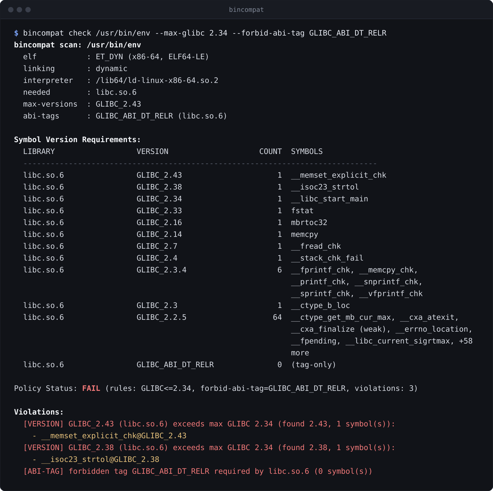

# bincompat

Static ELF64 scanner in zero-dependency safe Rust that checks Linux `GLIBC`/`GLIBCXX` symbol version floors, linker ABI tags, and binary hardening flags (`PIE`, `RELRO`, `NX`, stack canaries).



## Why

Ship a binary compiled on a newer Linux distro and it can fail to start on older LTS servers because one call pulled in `arc4random@GLIBC_2.36` or the linker emitted `GLIBC_ABI_DT_RELR` (`-z pack-relative-relocs`). Release builds can also silently drop `-fPIE`, `-z now`, or `-fstack-protector-strong` across toolchain changes.

`bincompat` parses `PT_INTERP`, `PT_GNU_RELRO`, `PT_GNU_STACK`, `SHT_DYNAMIC`, `SHT_DYNSYM`, `SHT_SYMTAB`, `SHT_GNU_VERSYM` (masking the `0x8000` hidden bit), and `SHT_GNU_VERNEED` directly, then fails CI with the exact library, version tag, offending symbols, or missing hardening flag.

## Usage

Build from source (`cargo build --release`, ~1s offline, ~400 KB stripped):

```bash
# Inspect DT_NEEDED, RPATH/RUNPATH, hardening flags, max symbol versions, and ABI tags
bincompat scan /usr/bin/env

# Fail CI if any symbol exceeds GLIBC 2.28 / GLIBCXX 3.4.28, pulls in DT_RELR, or drops hardening
bincompat check ./build/app \
  --max-glibc 2.28 \
  --max-glibcxx 3.4.28 \
  --forbid-abi-tag GLIBC_ABI_DT_RELR \
  --forbid-rpath \
  --require-hardening
```

Individual hardening flags (`--require-pie`, `--require-relro partial|full`, `--require-nx`, `--require-canary`) can also be used separately.

Exit codes: `0` pass, `1` policy violation, `2` I/O or malformed ELF error.

## Limitations

- ELF64 only (no ELF32, PE, or Mach-O).
- Static metadata scan only: does not catch symbols resolved dynamically via `dlopen`/`dlsym`.
- Distro compatibility presets, JSON/SARIF output, and binary `diff` mode are planned next.

## License

MIT. See [LICENSE](LICENSE).
